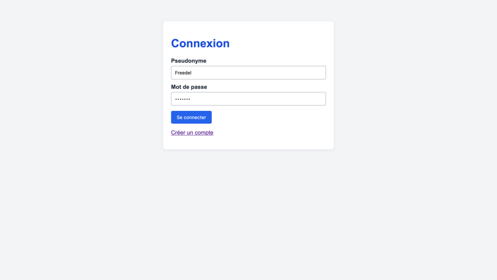
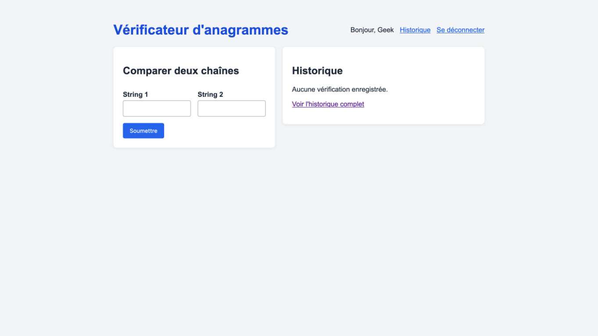
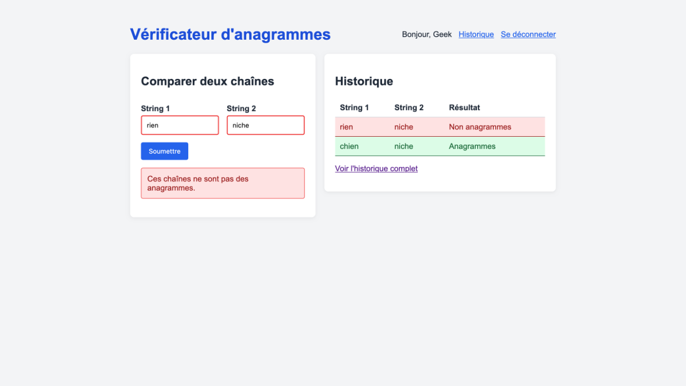
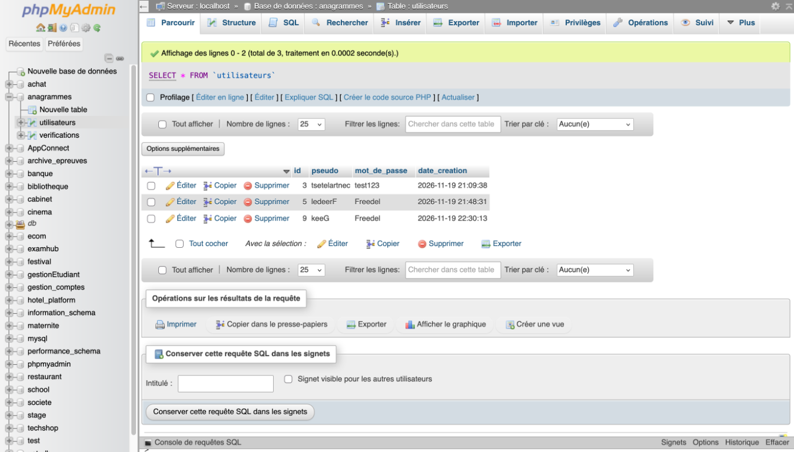

# Vérificateur d'anagrammes

## Installation

1. Démarrer Apache et MySQL dans XAMPP.
2. Importer la base :
   ```bash
   mysql -u root -p < database.sql
   ```
3. Adapter `config.php` si nécessaire.
4. Ouvrir `http://localhost/DevWeb/day3/`.

L'utilisateur doit d'abord s'inscrire ou se connecter. Les vérifications sont
alors enregistrées dans son historique personnel.

## Captures d'écran

### Connexion



### Inscription


### Vérificateur



### Résultat



### Base de données



## Pourquoi les pseudonymes sont inversés

La consigne demande la création de deux comptes lors de l'inscription :

1. le pseudonyme saisi ;
2. son inverse produit par `strrev()`.

Les deux comptes utilisent exactement le même mot de passe. Ils sont donc
présents tous les deux dans la table `utilisateurs`. Cette inversion est
volontaire et ne bloque pas une connexion : il faut saisir le pseudonyme exact
de l'une des deux lignes.

Les mots de passe sont stockés avec `password_hash()` et vérifiés avec
`password_verify()`. Les anciens mots de passe en clair sont convertis lors de
leur prochaine connexion.

Lors de la déconnexion, les deux pseudonymes du même couple sont supprimés de
la base. Une nouvelle connexion est ensuite possible uniquement après une
nouvelle inscription.

## Branches

- `main` : application finale.
- `day3` : branche de départ.
