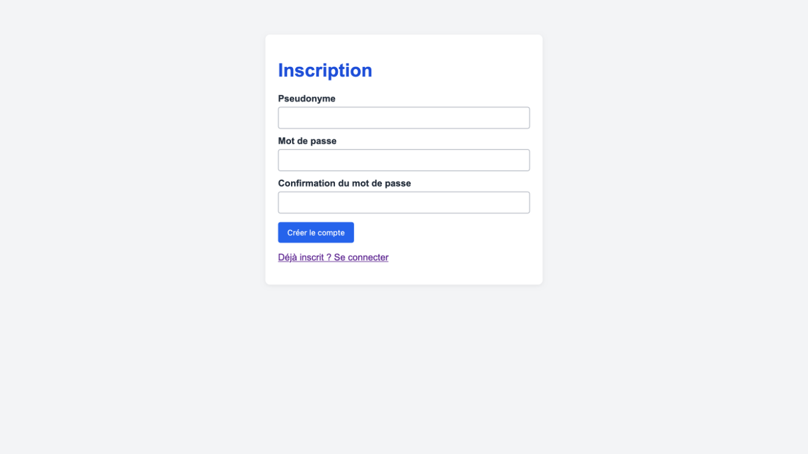

# Vérificateur d'anagrammes

## Installation

1. Démarrer Apache et MySQL dans XAMPP.
2. Importer la base :
   ```bash
   mysql -u root -p < database.sql
   ```
3. Adapter `config.php` si nécessaire.
4. Ouvrir `http://localhost/DevWeb/day3/`.

L'utilisateur doit d'abord s'inscrire ou se connecter. Les vérifications sont
alors enregistrées dans son historique personnel.

## Captures d'écran

### Connexion


### Inscription



### Vérificateur


### Résultat


## Branches

- `main` : application finale.
- `day3` : branche de départ.
